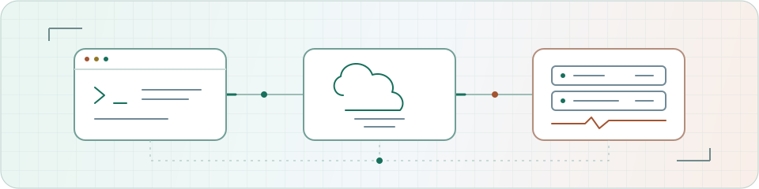

<a href="https://github.com/jacqueswolmarans?tab=repositories">
  <picture>
    <source media="(prefers-color-scheme: dark)" srcset="./assets/signal-path-dark.svg">
    <source media="(prefers-color-scheme: light)" srcset="./assets/signal-path-light.svg">
    
  </picture>
</a>

# Hey, I'm Jacques.

**Platform engineer. Solutions architect. Still happiest building things.**

I work across infrastructure, code and the web, from New Zealand. Sometimes that means designing an AWS platform. Sometimes it's writing an app, untangling a deployment, or helping a team work out what to build next.

I like useful software, understandable systems, and automating the jobs nobody wants to do twice.

[LinkedIn](https://www.linkedin.com/in/jacques-wolmarans/) &nbsp; / &nbsp; [Public repos](https://github.com/jacqueswolmarans?tab=repositories)

---
### Usually somewhere in this lot

**Cloud & infrastructure** / AWS, Terraform, Kubernetes, Docker, Linux **Code & automation** / Python, Go, Bash, Git, CI/CD **Visibility** / Prometheus, Grafana, Loki

Tools are the means, not the personality. I'll take a simple solution over another box on the architecture diagram.

---

**Build useful things. Leave fewer manual steps behind.**

---

### From idea to "it's running"

**01 / Build something useful** Web development, APIs, scripts and the glue between them. I enjoy working across the stack, not just handing things over at the infrastructure boundary.

**02 / Give it a good home** AWS, Linux, containers and infrastructure as code. Architecture that fits the problem, with a deployment path people can actually follow.

**03 / Make life easier for the team** Platform engineering and technical leadership: clear trade-offs, less manual work, and systems that are easier to operate when something goes sideways.

### A few things I've been building

[**edge-sre-agent**](https://github.com/jacqueswolmarans/edge-sre-agent) A read-only on-call sidekick. Ask in Slack; it checks Kubernetes, Prometheus and Loki, then answers with the evidence it used. Suggestions, not surprise changes to your cluster. `Python` `Kubernetes` `Observability`

[**Front Studio**](https://github.com/jacqueswolmarans/frontstudio) A website for fixed-price web development in NZ. Plain HTML, CSS and JavaScript. No framework required. `Web development` `HTML / CSS` `JavaScript`

[**Lanesight**](https://github.com/jacqueswolmarans/lanesight-demo) A fictional drive-thru analytics concept with a live vehicle simulation and interactive dashboard. Synthetic data, real front-end code. `JavaScript` `Canvas` `Data visualisation`

[**SRE-CloudHub**](https://github.com/jacqueswolmarans/SRE-CloudHub) A cloud/SRE learning repo exploring Terraform, Ansible, Kubernetes and observability on AWS.

---
